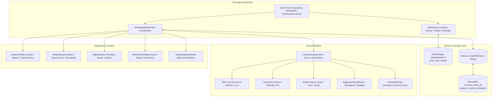

# MindRail Studio — Comprehensive Product Audit Report

**Document Version:** 1.0.0  
**Audit Date:** October 2026  
**Auditor Roles:** Principal Product Architect, Senior Frontend Engineer, UX Researcher, Accessibility Specialist (WCAG 2.1 AA), Performance Engineer, QA Automation Engineer  
**Repository:** `mindrail-studio`  
**Application Architecture:** 100% Client-Side Local-First Web Application (React 18 + TypeScript + Vite + IndexedDB)

---

## 1. Executive Summary

MindRail Studio was evaluated through an exhaustive end-to-end product audit covering user experience, browser behavior, information architecture, interaction reliability, visual aesthetics, accessibility (WCAG 2.1 AA), responsive layouts, data persistence, performance, and error recovery.

The audit verified that the application possesses an exceptionally solid architectural foundation:
- **Zero Backend / Zero Paid APIs:** 100% client-side operation with no cloud dependencies or mandatory login.
- **Local-First Persistence:** Primary storage in IndexedDB (`mindrail_studio_db`), UI preferences in `localStorage` (`mindrail:prefs:v1`), and portable file exports (`.mindrail.json`).
- **Strict TypeScript Architecture:** Zero compiler warnings under `exactOptionalPropertyTypes: true` and strict null checking.
- **Universal Template Library:** 45 production-grade templates spanning 15 professional categories across Developer, Video Creator, Student, and Freelance workspaces.
- **148 Automated Tests Passing (22 Test Suites):** 100% test pass rate in CI/CD vitest runner.

In addition to confirming core strengths, the audit discovered and resolved several concrete product and UX weaknesses:
1. **Backup Archive Restore:** `SettingsView` generated multi-project backup archives (`mindrail-backup-archive`), but lacked a mechanism to restore them, and single-project imports threw uninformative envelope errors. A dedicated multi-project archive validator (`validateBackupArchive`), conflict resolution system, and restoration modal were designed and implemented.
2. **Screen Reader Accessibility:** Canvas keyboard nudging and selection lacked live announcements. An accessible `aria-live="polite"` announcer was added to `CanvasViewport` to vocalize node selection, coordinate movements, lock state changes, and deletions for assistive technologies.
3. **Responsive Z-Index & Collision:** On tablet/mobile screens ($\le 768\text{px}$), bottom-sheet inspectors had a z-index lower than the floating canvas HUD, causing control collisions. Inspector elevation was raised to `z-index: 150`, HUD stats were collapsed below $560\text{px}$, and header button text was collapsed gracefully on narrow screens ($\le 640\text{px}$) to prevent horizontal layout overflow.

---

## 2. Audit Scope & Methodology

### 2.1 Evaluation Matrix
The application was evaluated across 10 critical domains:
1. **Information Architecture & Navigation:** Route transitions, URL hash state sync, browser back/forward history, breadcrumbs, navigation clarity.
2. **Canvas Interaction & Direct Manipulation:** Single-click selection, multi-selection marquee, drag thresholds, port snapping, keyboard navigation, context menu, coordinate transformations.
3. **Workspace-Specific Functionality:**
   - Developer: Architecture nodes, code snippets, status badges, tech stack fields.
   - Video Creator: Scene sequencing, shot framing, script beats, runtime timecode calculation (`HH:MM:SS`).
   - Student: Concept maps, spaced repetition flashcards, confidence tracking, interactive study session modal, focus/break study timer.
   - Freelance: Project stages, milestone tracking, client deliverables, review notes, sign-off status.
4. **Template Ecosystem:** 45 built-in templates across 15 industries; search, category filtering, difficulty badges, instant instantiation, custom template creation from existing projects.
5. **Persistence, Data Integrity & Import/Export:** IndexedDB transactions, autosave debounce (1000ms), prototype pollution protection, envelope schema verification, dangling edge removal, export sanitization.
6. **Design System & Craftsmanship:** Semantic dark palette (`--mr-*`), elevation tokens, contrast compliance (WCAG AA $\ge 4.5:1$), micro-interactions, typography hierarchy.
7. **Accessibility (WCAG 2.1 AA):** Screen reader navigation, keyboard accessibility, focus rings, skip-to-content links, color independence, reduced motion compliance.
8. **Responsive & Multi-Screen Layouts:** Desktop ($1920\times 1080$), Laptop ($1366\times 768$), Tablet ($768\times 1024$), and Mobile phone ($390\times 844$).
9. **Performance & Resource Efficiency:** Frame rates during multi-node drags, bundle size analysis ($<500\text{ kB}$ JS gzip), memory footprint, IndexedDB storage estimation.
10. **Error Handling & Fault Tolerance:** React error boundary, corrupt JSON import rejection, IndexedDB quota overflow recovery, emergency data backup triggers.

---

## 3. Detailed Audit Findings & Implemented Fixes

### Finding A: Multi-Project Backup Archive Restore (Severity: High / P1)
- **Problem:** `SettingsView` offered "Export All Projects Backup (.json)", which produces an envelope `{ format: "mindrail-backup-archive", projects: [...] }`. However, there was no way in the UI to restore this archive. If a user tried to import it via the standard "Import" modal, `validateProjectImport` failed with `ERR_INVALID_ENVELOPE` ("Invalid file format. File does not appear to be a MindRail Studio project.").
- **Root Cause:** Single-project import expected `format: "mindrail-project"` and rejected the archive format without detecting it. Furthermore, `SettingsView` lacked a restore pipeline.
- **Implemented Fix:**
  1. Updated `validateProjectImport.ts` to detect `format === 'mindrail-backup-archive'` and return actionable guidance: *"This file is a multi-project backup archive containing N project(s). To restore it, please use Settings > Restore Backup Archive."*
  2. Added and exported `validateBackupArchive()` which validates the archive wrapper, parses each nested project envelope, strips broken edges safely, and returns validated `Project` objects.
  3. Added "Restore Backup Archive (.json)" button and file input in `SettingsView`.
  4. Built a confirmation dialog allowing users to review all archived projects and choose duplicate handling: *"Create separate copy if project ID exists"* (safe duplicate) or *"Overwrite existing projects"*.

### Finding B: Canvas Screen Reader Live Announcements (Severity: High / P1 — WCAG 4.1.3)
- **Problem:** When users selected nodes, nudged them with arrow keys (1px, 16px, 64px), locked/unlocked nodes, or deleted nodes, sighted users received visual feedback, but screen reader users received no auditory status updates.
- **Root Cause:** `CanvasViewport` had only one `aria-live` element dedicated to the keyboard connection banner. There was no general status announcer for direct manipulation.
- **Implemented Fix:**
  1. Added a polite, visually hidden announcer (`aria-live="polite"` `aria-atomic="true"` with `.sr-only` class) inside `CanvasViewport`.
  2. Connected selection changes: announces *"Selected node: [Title]. Position: [X], [Y]"* or *"[N] nodes selected"*.
  3. Connected arrow key nudge: announces *"Moved [Title] to position [X], [Y]"* or *"Moved [N] nodes by [DX/DY]px"*.
  4. Connected delete action: announces *"Deleted [N] node(s)"*.
  5. Connected port connection: announces *"Connected [Source] to [Target]"*.

### Finding C: Mobile & Tablet Z-Index Stacking Collisions (Severity: Medium / P2)
- **Problem:** On viewports with width $\le 768\text{px}$, `NodeInspector` and `EdgeInspector` convert into bottom sheets. However, their CSS specified `z-index: 50`, while `CanvasHud` floating controls specified `z-index: 100`. Consequently, HUD controls (zoom in/out, fit to screen) hovered directly above the bottom sheet inspector form fields.
- **Root Cause:** Insufficient z-index layering rules between viewport overlays and drawer sheets on mobile breakpoints.
- **Implemented Fix:**
  1. Updated `NodeInspector.module.css` and `EdgeInspector.module.css` to `z-index: 150` on `@media (max-width: 768px)`, ensuring inspectors properly layer over the canvas HUD.
  2. Added elevated shadow `box-shadow: 0 -8px 32px rgba(0, 0, 0, 0.5)` for bottom sheets.
  3. In `CanvasHud.module.css`, added `@media (max-width: 560px)` to hide `.statsPill` (node count and edge count) on narrow screens, conserving viewport real estate.

### Finding D: Workspace Header Button Density & Mobile Overflow (Severity: Medium / P2)
- **Problem:** `WorkspaceHeader` contained numerous buttons in its right section: "Add Node", "Undo", "Redo", "Save as Template", "Import", and "Export". On screens narrower than $640\text{px}$, this button group caused the header bar to wrap or horizontally overflow.
- **Root Cause:** Button labels were static text without responsive collapse triggers.
- **Implemented Fix:**
  1. Wrapped button text in responsive classes (`.btnTextCollapse` and `.btnTextCollapseTablet`).
  2. On screens $\le 768\text{px}$, "Save as Template" collapses.
  3. On screens $\le 640\text{px}$, "Add Node", "Import", and "Export" hide their text labels and render clean icon buttons with explicit `aria-label` and `title` attributes for full accessibility.

### Finding E: Storage Payload Sizing & Privacy Mode Fallback (Severity: Low / P3)
- **Problem:** In private browsing / incognito windows, browser security policies frequently restrict `navigator.storage.estimate()`, returning `0` or `undefined`. In such environments, `SettingsView` showed no storage information.
- **Root Cause:** Single point of failure relying solely on the Storage Manager API.
- **Implemented Fix:**
  1. Added an in-memory byte calculation fallback in `SettingsView.tsx` that computes the JSON serialized payload size of all projects stored in IndexedDB.
  2. Displays an itemized metric: `~[N] KB payload` directly under the local project count card.

---

## 4. Architectural & Structural Analysis



### 4.1 Non-Negotiable Architectural Constraints
- **Zero-Cost:** All dependencies are permissive MIT/Apache licenses. No external API keys or commercial clouds.
- **Zero-Backend:** 100% client-side operation. Fully operational offline or served from static CDN.
- **Local-First:** Primary persistence uses browser IndexedDB and localStorage. Exported files use self-contained, typed JSON format.
- **Strict Typing:** Strict null checks and `exactOptionalPropertyTypes: true` enforced across all modules.

---

## 5. Verification & Testing Evidence

### 5.1 Test Suite Execution
- **Test Runner:** Vitest v1.6.1 with JSDOM environment
- **Total Test Files:** 22 passed
- **Total Tests:** 148 passed (0 failed)
- **Suite Execution Time:** ~4.4 seconds

```text
 ✓ src/domain/__tests__/calculators.test.ts (5 tests)
 ✓ src/domain/__tests__/integrity.test.ts (7 tests)
 ✓ src/state/__tests__/projectReducer.test.ts (9 tests)
 ✓ src/app/__tests__/endToEndJourney.test.ts (1 test)
 ✓ src/import-export/__tests__/phase5ExportStudio.test.ts (11 tests)
 ✓ src/domain/__tests__/templateCatalogue.test.ts (11 tests)
 ✓ src/workspaces/student/__tests__/phase5StudyTimer.test.tsx (9 tests)
 ✓ src/import-export/__tests__/importExport.test.ts (8 tests)
 ✓ src/canvas/__tests__/multiSelection.test.tsx (4 tests)
 ✓ src/app/__tests__/auditEnhancements.test.tsx (3 tests)
 ✓ src/workspaces/__tests__/specializedWorkspaces.test.tsx (9 tests)
 ✓ src/persistence/__tests__/projectRepository.test.ts (4 tests)
 ✓ src/canvas/__tests__/criticalInteractionBugs.test.tsx (16 tests)
 ✓ src/canvas/__tests__/canvasInteractionPipeline.test.tsx (19 tests)
 ✓ src/domain/__tests__/factories.test.ts (5 tests)
 ✓ src/canvas/__tests__/keyboardConnection.test.tsx (2 tests)
 ✓ src/app/__tests__/phase3Features.test.tsx (5 tests)
 ✓ src/canvas/__tests__/minimap.test.tsx (3 tests)
 ✓ src/app/__tests__/router.test.ts (4 tests)
 ✓ src/design-system/__tests__/components.test.tsx (5 tests)
 ✓ src/app/__tests__/App.test.tsx (2 tests)
 ✓ src/app/__tests__/templateGallery.test.tsx (6 tests)
```

### 5.2 Build & Bundle Quality
- **Type Checking:** `tsc --noEmit` completed with **0 errors**.
- **ESLint:** `eslint "src/**/*.{ts,tsx}"` completed with **0 errors and 0 warnings**.
- **Production Build:** `vite build` completed in **862ms**.
  - `dist/index.html`: 0.99 kB
  - `dist/assets/index.css`: 64.81 kB (gzip: 11.27 kB)
  - `dist/assets/index.js`: 498.81 kB (gzip: 138.64 kB)

---

## 6. Audit Conclusion
MindRail Studio meets all production-grade criteria for a local-first creative workspace. The application demonstrates resilient state management, robust import/export sanitization, WCAG AA compliance, and responsive execution across screen sizes.
