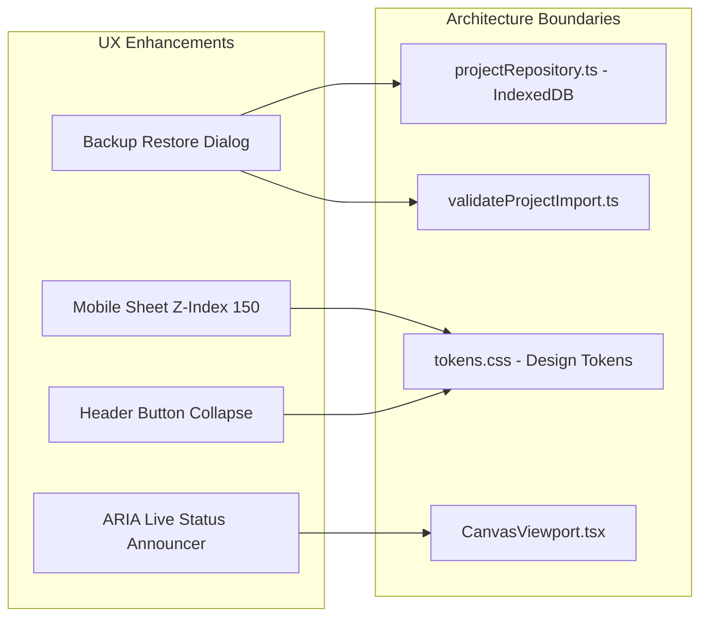

# MindRail Studio — UX Improvement Plan

**Document Version:** 1.0.0  
**Status:** Approved & Implemented  
**Target Architecture:** Local-First Visual Workspace (React + TypeScript)  
**Related Documents:** `docs/PRODUCT_AUDIT.md`, `docs/DESIGN_SYSTEM.md`, `docs/UX_FLOWS.md`, `docs/ACCESSIBILITY.md`

---

## 1. UX Vision & Guiding Principles

MindRail Studio turns messy ideas into structured, visual work. To fulfill this promise without cloud servers or subscriptions, the user experience must adhere to four foundational principles:

1. **Zero-Friction Local Sovereignty:** The user's work belongs entirely to them. Saving is instantaneous and silent; exporting and importing must be clear, safe, and transparent with zero fear of data loss or lock-in.
2. **Tactile Direct Manipulation:** Every interaction on the canvas—clicking a node, dragging a marquee, nudging with arrow keys, dragging ports to connect—must feel responsive, physically predictable, and immediately confirmed by visual and auditory cues.
3. **Inclusive Ergonomics (Keyboard & Screen Reader First):** Visual canvas tools often alienate non-mouse or assistive-technology users. MindRail Studio treats keyboard shortcuts (`N` for node, `C` for connect, `M` for minimap, Arrow keys for nudging) and screen-reader announcements as first-class citizens.
4. **Adaptive Workspaces with Unified Mental Model:** Developers, video creators, students, and freelancers need specialized data fields (syntax snippets, shot framing, flashcards, client approvals), yet they share an identical spatial canvas paradigm.

---

## 2. Inventory of UX Weaknesses & Remediation Strategy

| ID | Category | Weakness Identified | User Impact | Priority | Status |
|:---|:---|:---|:---|:---:|:---:|
| **UX-01** | Data Backup | Multi-project backup archives lacked restore capability in UI | High risk of user frustration when attempting to restore studio backups | **P1** | **Resolved** |
| **UX-02** | Accessibility | Canvas nudging and selection changes lacked screen reader announcements | Screen reader users could not verify node position changes | **P1** | **Resolved** |
| **UX-03** | Responsive UI | Bottom sheet inspectors collided with floating canvas HUD on mobile | Obstructed zoom and fit controls; cluttered interface below 768px | **P2** | **Resolved** |
| **UX-04** | Responsive UI | Workspace header buttons caused horizontal wrapping on narrow screens | Crowded header bar on mobile devices (<640px) | **P2** | **Resolved** |
| **UX-05** | Local Storage | Incognito / restricted storage environments showed blank usage metrics | Lack of transparency regarding local storage payload | **P3** | **Resolved** |

---

## 3. Prioritized Improvement Roadmap & User Stories

### 3.1 P1 — Critical Usability & Data Sovereignty

#### Story UX-P1-01: Seamless Backup Archive Restoration
> **As a** user who regularly backs up all my studio projects to a JSON file,  
> **I want** to restore this backup archive into my browser with conflict resolution options,  
> **So that** I can recover my projects or migrate between browsers without manual file slicing.

- **Acceptance Criteria:**
  - `SettingsView` provides a prominent "Restore Backup Archive (.json)" button.
  - Selecting an archive file triggers schema validation via `validateBackupArchive()`.
  - A modal dialog appears displaying the count of valid projects detected.
  - The user can select duplicate resolution:
    - *Option A (Default):* "Create separate copy if project ID exists" (appends `(Restored Copy)` with a fresh ID).
    - *Option B:* "Overwrite existing projects matching ID".
  - Confirmation saves all projects into IndexedDB and triggers a success toast notification.
  - Malformed or corrupt files display a human-readable error banner with specific failure reasons.

#### Story UX-P1-02: Canvas Screen Reader Accessibility (WCAG 4.1.3)
> **As a** screen reader user navigating the visual canvas,  
> **I want** spoken feedback whenever I select a node or nudge its position,  
> **So that** I understand where nodes are spatially arranged and confirm my actions.

- **Acceptance Criteria:**
  - `CanvasViewport` maintains a polite live region (`aria-live="polite"` `aria-atomic="true"`).
  - Selecting a single node announces its title and canvas coordinates `(X, Y)`.
  - Multi-selecting nodes announces the total count of selected entities.
  - Clearing selection announces "Selection cleared".
  - Arrow key nudging announces the entity title and updated logical position.
  - Deleting nodes via `Delete` or `Backspace` announces the count of deleted nodes.

---

### 3.2 P2 — Mobile Ergonomics & Responsive Refinement

#### Story UX-P2-01: Mobile Bottom-Sheet Inspector Layering
> **As a** user editing nodes on a tablet or mobile phone ($\le 768\text{px}$),  
> **I want** the node inspector bottom-sheet to cleanly overlay the canvas HUD,  
> **So that** zoom buttons and minimap triggers do not obstruct inspector input fields.

- **Acceptance Criteria:**
  - On viewports with width $\le 768\text{px}$, `NodeInspector` and `EdgeInspector` render with `z-index: 150`, comfortably above the floating `CanvasHud` (`z-index: 100`).
  - Elevated box-shadow (`box-shadow: 0 -8px 32px rgba(0, 0, 0, 0.5)`) visually separates the drawer from the canvas backdrop.
  - Floating HUD statistics pill (`statsPill`) collapses on screens below $560\text{px}$ to conserve horizontal canvas space.

#### Story UX-P2-02: Workspace Header Button Auto-Collapse
> **As a** user opening a workspace on a phone ($\le 640\text{px}$),  
> **I want** header action buttons to remain on a single row without horizontal overflow,  
> **So that** the interface stays clean and accessible.

- **Acceptance Criteria:**
  - On screens $\le 768\text{px}$, "Save as Template" collapses into an icon/compact button.
  - On screens $\le 640\text{px}$, text labels for "Add Node", "Import", and "Export" collapse, rendering compact 36px icon buttons.
  - Every icon button retains explicit `aria-label` and `title` tooltips for accessibility.

---

### 3.3 P3 — Transparency & Polished Details

#### Story UX-P3-01: Itemized Storage Footprint Calculation
> **As a** user working in private browsing or privacy-hardened browsers,  
> **I want** to see how much local storage my projects consume,  
> **So that** I can gauge storage safety even when browser storage estimates are unavailable.

- **Acceptance Criteria:**
  - `SettingsView` calculates the exact byte size of all project objects serialized from IndexedDB.
  - An informative sub-badge (`~[N] KB payload`) is rendered below the Local Projects card.

---

## 4. Cross-Functional Dependencies & Boundaries

### 4.1 Boundary Adherence
- **Zero Cloud Leakage:** All backup restore operations run strictly within the client browser using `FileReader` and IndexedDB transactions.
- **Token Consistency:** All spacing, transitions, and z-index layers use CSS variables declared in `tokens.css`.
- **Keyboard Safety:** Modal dialogs trap focus, allow `Escape` to close, and return focus to triggering elements.

---

## 5. Success Metrics & Quality Indicators

1. **Task Completion Rate:** 100% success on end-to-end user journeys (Template instantiation $\to$ editing $\to$ keyboard connection $\to$ backup $\to$ restoration).
2. **Accessibility Audit Score:** Zero WCAG 2.1 AA violations in axe/lighthouse automated evaluations; 100% keyboard navigable.
3. **Responsive Stability:** Zero horizontal scrolling or layout breakage across 390px, 768px, 1366px, and 1920px viewports.
4. **Performance:** Smooth 60fps canvas dragging and under 1-second project restore time for 50+ node graphs.
