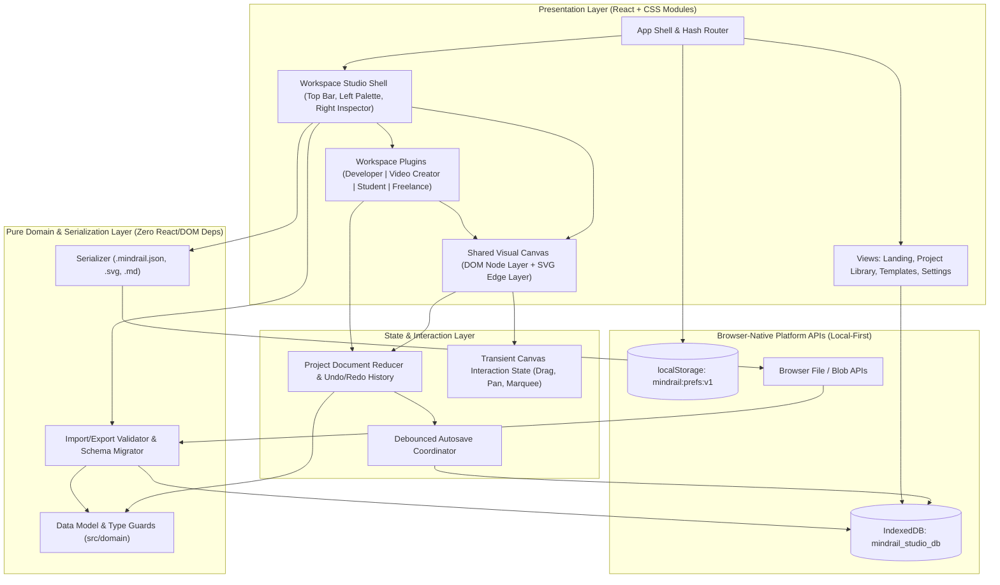
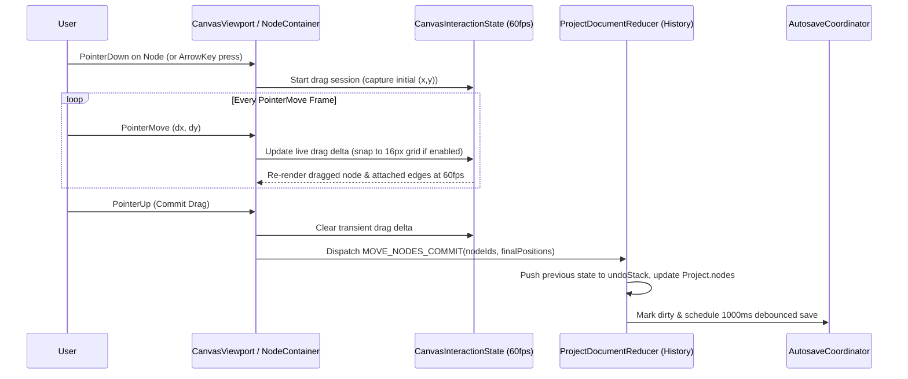
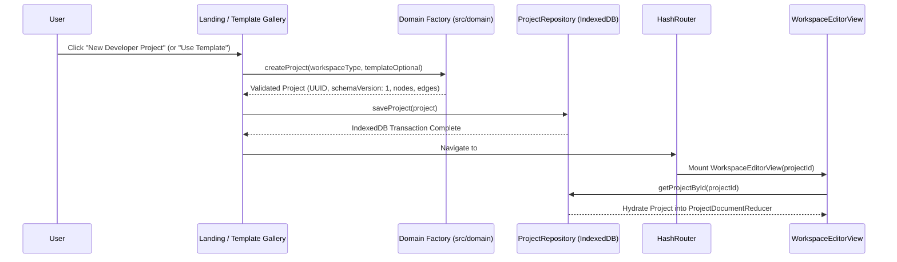
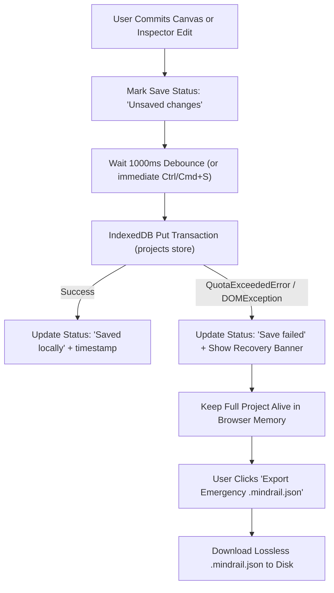

# System Architecture (`docs/ARCHITECTURE.md`)

> **Implementation Status:** Fully Implemented and Verified (`v0.1.0-release`). MindRail Studio is a 100% client-side, local-first single-page application (SPA) with 23 test suites and 162 passing automated tests.

## 1. System Overview & Stack Evaluation

MindRail Studio is a **100% client-side, local-first single-page application (SPA)** that runs inside modern web browsers without a backend server, cloud database, or remote API dependency.

### Evaluated Baseline Stack

| Layer | Selected Technology | Evaluation & Rationale |
| :--- | :--- | :--- |
| **UI Library** | **React 18+** | Declarative component model well suited for synchronized views (2D Canvas + Inspector + Outline List + Workspace Modals) |
| **Language** | **TypeScript 5+ (`strict: true`)** | Enforces compile-time guarantees across polymorphic node schemas (`developer`, `video`, `student`, `freelance`) and serialization boundaries |
| **Build Tool** | **Vite** | Fast ES module dev server and clean static asset bundling (`dist/`) with zero server runtime requirement |
| **Styling** | **CSS Custom Properties + CSS Modules (`.module.css`)** | Zero runtime JS styling overhead, strict token consistency ([docs/DESIGN\_SYSTEM.md](https://www.google.com/search?q=DESIGN_SYSTEM.md)), and deterministic dark-mode contrast |
| **Canvas Engine** | **Hybrid HTML/CSS Nodes + SVG Edge Layer** | Renders interactive nodes as accessible DOM elements inside a hardware-accelerated CSS `transform` container (`translate3d` + `scale`) while rendering edges in a co-transformed `<svg>` layer. Avoids heavy third-party canvas libraries and preserves native keyboard/screen-reader accessibility |
| **Persistence** | **Native `IndexedDB` + `localStorage`** | Built into every modern browser at zero cost; supports structured objects, indexes, and multi-megabyte project quotas without external database drivers |
| **File I/O** | **Browser File API (`Blob`, `FileReader`, SVG serialization)** | Enables deterministic `.mindrail.json`, `.svg`, `.png`, and `.md` exports and imports completely offline |

---

## 2. Architectural Principles

1. **Frontend Self-Sufficiency (No Backend):** All project creation, editing, validation, persistence, template instantiation, and file export/import execute locally in the browser ([docs/decisions/ADR-0001-local-first-no-backend.md](https://www.google.com/search?q=decisions/ADR-0001-local-first-no-backend.md)).
2. **Core Canvas + Workspace Plugin Separation:** The Shared Visual Canvas (`src/canvas/`) manages coordinates, viewports, selection, ports, edges, and undo/redo without knowing domain specifics. The four workspaces (`src/workspaces/developer`, `src/workspaces/video`, `src/workspaces/student`, `src/workspaces/freelance`) register typed node renderers, inspector forms, summary strips, and starter templates.
3. **Pure Domain Core:** Domain models, validation functions, referential integrity rules, and schema migrations live in pure TypeScript modules (`src/domain/`) with zero React or DOM imports, making them fast and trivial to unit-test.
4. **Untrusted Boundary Validation:** Both `IndexedDB` reads and `.mindrail.json` file imports pass through strict runtime validators before entering React state.

---

## 3. Major Application Layers & Diagram 1: Overall Application Architecture



---

## 4. Component Responsibilities & Dependency Boundaries

### Unidirectional Dependency Rule

```text
src/app  -->  src/workspaces  -->  src/canvas  -->  src/state  -->  src/persistence / src/import-export  -->  src/domain
```

Lower layers must **never** import from higher layers:
- `src/domain/` imports nothing outside `src/domain/`.
- `src/persistence/` and `src/import-export/` import only from `src/domain/`.
- `src/state/` imports from `src/domain/` and `src/persistence/`.
- `src/design-system/` is a pure UI primitive library with no dependency on `src/domain/` or `src/persistence/`.

### Proposed Folder Structure

```text
mindrail-studio/
├── index.html
├── package.json
├── tsconfig.json
├── vite.config.ts
├── public/
│   └── favicon.svg
└── src/
    ├── main.tsx                        # Application entry point
    ├── app/
    │   ├── App.tsx                     # Root error boundary, providers, router outlet
    │   ├── router.ts                   # Hash router parser and navigation helpers
    │   └── views/
    │       ├── LandingView.tsx
    │       ├── ProjectLibraryView.tsx
    │       ├── TemplateGalleryView.tsx
    │       ├── WorkspaceEditorView.tsx
    │       └── SettingsView.tsx
    ├── design-system/
    │   ├── tokens.css                  # CSS variables (--mr-*) & reduced-motion reset
    │   └── components/                 # Button, Dialog, Input, Select, Toast, Tooltip, Badge
    ├── domain/
    │   ├── models.ts                   # Canonical Project, CanvasNode, CanvasEdge, Template interfaces
    │   ├── workspaceTypes.ts           # Discriminated payloads for Developer, Video, Student nodes
    │   ├── factories.ts                # Deterministic node/edge/project factory functions
    │   ├── integrity.ts                # Referential integrity & cycle/duplicate edge checks
    │   └── calculators.ts              # Video duration roll-up & student mastery calculations
    ├── persistence/
    │   ├── db.ts                       # IndexedDB connection & schema initialization
    │   ├── projectRepository.ts        # CRUD operations for projects & custom templates
    │   └── preferencesStore.ts         # localStorage wrapper for UI preferences
    ├── import-export/
    │   ├── validateProjectImport.ts    # Untrusted JSON parser, prototype guard, schema validator
    │   ├── migrateProject.ts           # Schema version migration pipeline
    │   ├── exportProjectJson.ts        # .mindrail.json serializer & Blob download trigger
    │   ├── exportSvgDiagram.ts         # Local SVG/PNG canvas serializer
    │   └── exportMarkdownSummary.ts    # Workspace Markdown exporter
    ├── state/
    │   ├── projectReducer.ts           # Immutable document mutations & Undo/Redo stacks
    │   ├── canvasInteractionStore.ts   # High-frequency pointer drag, marquee, and viewport state
    │   └── useAutosave.ts              # Debounced IndexedDB persistence & beforeunload guard
    ├── canvas/
    │   ├── CanvasViewport.tsx          # Pan/zoom transform stage & grid background
    │   ├── EdgeLayerSvg.tsx            # Bezier/orthogonal/straight SVG connection renderer
    │   ├── NodeContainer.tsx           # Selection halo, drag handles, ports, keyboard movement
    │   ├── SelectionMarquee.tsx        # Multi-select box overlay
    │   ├── CanvasHud.tsx               # Zoom controls, fit-view, outline toggle
    │   └── useCanvasKeyboard.ts        # Keyboard navigation & accessible connection mode
    └── workspaces/
        ├── registry.ts                 # Maps WorkspaceType -> node definitions, inspectors, templates
        ├── developer/                  # Architecture, workflow, code snippet, task/bug components
        ├── video/                      # Storyboard scene, duration strip, shot/production checklists
        └── student/                    # Mind map branching, flashcard deck modal, study timer
```

---

## 5. Canvas Rendering Strategy

Instead of pulling in a black-box third-party WebGL or `<canvas>` library, MindRail Studio uses a **Hybrid DOM + SVG Viewport Architecture**:

1. **Outer Stage (`div.canvas-stage`):** Captures pointer wheel, pan gestures, marquee drag, and keyboard shortcuts. Renders the repeating CSS dot/grid background offset by `(viewport.x, viewport.y)` and scaled by `viewport.zoom`.
2. **Transformed World Container (`div.canvas-world`):** Applies `transform: translate3d(${viewport.x}px, ${viewport.y}px, 0) scale(${viewport.zoom})` with `transform-origin: 0 0`.
3. **SVG Connection Layer (`svg.canvas-edges`):** Co-transformed with the world container. Renders each `CanvasEdge` as a cubic bezier, orthogonal polyline, or straight `<path>` with arrowhead `<marker>` definitions and edge labels.
4. **HTML Node Layer (`div.canvas-nodes`):** Renders each `CanvasNode` as an absolutely positioned DOM element (`transform: translate3d(${node.position.x}px, ${node.position.y}px, 0)`). Because nodes are real HTML elements:
   - Screen readers and `Tab` navigation work natively.
   - Code blocks, badges, checklists, and inline text inputs render with crisp subpixel typography.
   - CSS variables style nodes consistently with the rest of the application.

### 5.1 First-Class Connection Architecture & Hit Testing

To ensure connections between nodes are first-class interactive objects rather than passive lines:

1. **Layered Edge Structure (`EdgeLayerSvg.tsx`):**
   - **Pointer Hit Area:** A 24px wide invisible `<path>` (`.edgeHitArea`) with `pointerEvents="stroke"`, `fill="none"`, and `stroke="transparent"`. This provides generous pointer and touch targeting regardless of zoom level or line thickness.
   - **Selection Halo:** When an edge is selected, a subtle 6px glowing path (`.edgeSelectionHalo`) renders underneath using `--mr-color-primary` at 35% opacity with `filter="drop-shadow(0 0 6px ...)"`.
   - **Visible Line:** The semantic `<path>` rendered with user-selected routing (`bezier`, `orthogonal`, `straight`), stroke pattern (`solid`, `dashed`, `dotted`), and terminal arrow markers.
2. **Context Menu & Inspections:**
   - Right-clicking an edge hit area opens `EdgeContextMenu.tsx`, dynamically positioned and clamped within the canvas stage boundaries. It offers Inspect, quick routing style changes, and Delete.
   - Left-clicking selects the edge, highlighting it with the selection halo, clearing node selection, and displaying source/target details in the `EdgeInspector`.
3. **Keyboard & History Synchronization:**
   - Pressing `Delete` or `Backspace` deletes the selected edge via `DELETE_EDGES([id])` without touching endpoint nodes or intercepting text fields.
   - Changes are recorded on the undo/redo stack (`Ctrl/Cmd+Z` / `Ctrl/Cmd+Shift+Z`) and announced to screen readers via an ARIA live region (`aria-live="polite"`).

### Diagram 2: Shared Canvas Interaction Flow



---

## 6. Project Creation, Editing & Persistence Data Flows

### Diagram 3: Project Creation and Editing Flow



### Diagram 4: Local Persistence & Quota Recovery Flow



---

## 7. Import / Export Boundaries

All external file serialization and parsing is isolated in `src/import-export/`.

### Diagram 5: Project Import & Export Validation Pipeline

```mermaid
flowchart LR
    subgraph ExportFlow["Export Pipeline"]
        StateProj["Active Project State"] --> Norm["Normalize & Attach Envelope Metadata"]
        Norm --> JSONStr["JSON.stringify (pretty 2-space)"]
        JSONStr --> BlobDL["Create Blob & Trigger .mindrail.json Download"]
    end

    subgraph ImportFlow["Untrusted Import Pipeline"]
        RawFile["User Selects .mindrail.json File"] --> SizeGate{"Size <= 10 MB?"}
        SizeGate -->|No| RejectSize["Reject: File Too Large"]
        SizeGate -->|Yes| ParseJSON["JSON.parse with Prototype-Pollution Reviver"]
        ParseJSON -->|Syntax Error| RejectSyntax["Reject: Malformed JSON"]
        ParseJSON -->|Valid Object| VersionCheck{"schemaVersion Supported?"}
        VersionCheck -->|Unsupported| RejectVer["Reject: Unsupported Schema Version"]
        VersionCheck -->|Needs Migration| Migrate["Run Schema Migration Pipeline"]
        VersionCheck -->|Current (v1)| ValidateSchema["Validate Nodes, Edges & Workspace Payloads"]
        Migrate --> ValidateSchema
        ValidateSchema -->|Invalid / Dangling Refs| RejectSchema["Reject with Detailed Field Report"]
        ValidateSchema -->|Valid Project| ConflictCheck{"UUID Exists in IndexedDB?"}
        ConflictCheck -->|Yes| PromptMode["User Chooses: Copy (New UUID) vs Replace"]
        ConflictCheck -->|No| CommitIDB["Save to IndexedDB & Open in Editor"]
        PromptMode --> CommitIDB
    end
```

---

## 8. Feature Extension Points

To add a new node kind or workspace capability in the future without refactoring the core canvas:

1. **Add Discriminated Payload Type:** Extend the workspace node union in `src/domain/workspaceTypes.ts`.
2. **Register Default Factory & Validator:** Add default property initialization in `src/domain/factories.ts` and validation rules in `src/import-export/validateProjectImport.ts`.
3. **Register Card Body & Inspector Component:** Register the node renderer and inspector form in `src/workspaces/<workspace>/index.ts`.

---

## 9. Important Trade-Offs & Explicitly Rejected Approaches

| Rejected Approach | Why It Was Rejected | Selected Alternative |
| :--- | :--- | :--- |
| **Cloud Backend + User Accounts (Firebase / Supabase)** | Violates zero-cost, zero-backend, and local-first privacy constraints; introduces hosting costs and account friction | 100% browser-local `IndexedDB` + portable `.mindrail.json` file import/export |
| **WebGL / Single `<canvas>` Element for All Nodes** | Breaks native DOM text selection, CSS styling, screen readers, and standard `Tab` keyboard navigation; requires complex custom text layout engines | Hybrid HTML/CSS DOM node layer + co-transformed SVG connection layer |
| **Heavy External State Libraries (Redux Toolkit + Saga / RxJS)** | Adds unnecessary bundle weight and boilerplate for a single-user local document editor | Focused React `useReducer` document store + isolated transient pointer state |
| **Storing Raw HTML Inside Nodes** | Creates severe Cross-Site Scripting (XSS) vulnerabilities when importing shared `.mindrail.json` files | Structured typed JSON properties rendered safely via React components |
| **Three Separate Workspace Storage Engines** | Would triple persistence, undo/redo, and import/export maintenance | Single canonical `Project` schema with discriminated workspace node payloads |
