# Phased Implementation Plan (`docs/IMPLEMENTATION_PLAN.md`)

> **Current Status:** Phases 0, 1, 2, 3, 4, 5, 6 & 7 Implemented & Verified. Production Release Ready (24 test suites, 170 passing automated tests, 0 type errors, 0 lint warnings).
>
> **Guiding Principle:** Prioritize a small, complete, verified vertical slice over partial or mock implementations of every feature. Never advance to the next phase until the current phase's **Acceptance Criteria**, **Verification Commands**, and **Definition of Done** are satisfied.

---

## Phase Overview & Dependency Graph

```mermaid
graph LR
    P0["Phase 0: Repository & Foundation (Completed)"] --> P1["Phase 1: First Functional Vertical Slice (Completed)"]
    P1 --> P2["Phase 2: Canvas Usability & History (Completed)"]
    P2 --> P3["Phase 3: Product Experience & Galleries (Completed)"]
    P3 --> P4["Phase 4: Specialized Workspaces (Completed)"]
    P4 --> P5["Phase 5: Quality, Export Studio & Release (Completed)"]
    P5 --> P6["Phase 6: Universal Ecosystem & Connections (Completed)"]
    P6 --> P7["Phase 7: Previews, Discovery & Hardening (Completed)"]
```



---

## Phase 0 — Repository and Project Foundation

### Objective
Bootstrap the React + TypeScript + Vite toolchain, testing runner, design system CSS tokens, accessible UI primitives, and basic application shell with hash routing.

### Dependencies
- None (first implementation phase; relies on the completed documentation baseline).

### Deliverables
1. `package.json`, `tsconfig.json`, `vite.config.ts`, `index.html` (with strict CSP meta tag).
2. Configured test runner (`Vitest` + `@testing-library/react` + `fake-indexeddb`).
3. `src/design-system/tokens.css` implementing all semantic dark-mode tokens and reduced-motion rules from [docs/DESIGN_SYSTEM.md](docs/design_system.md).
4. Core accessible UI primitives (`Button`, `Dialog`, `Input`, `Badge`, `Toast`).
5. `src/app/router.ts` and `src/app/App.tsx` rendering the route shell (`#/`, `#/projects`, `#/templates`, `#/workspace/:workspaceType/:projectId`, `#/settings`).

### Implementation Tasks
- [x] **Task 0.1:** Initialize `package.json` (React 18, TypeScript 5, Vite, Vitest, React Testing Library, `fake-indexeddb`, ESLint) after verifying permissive licenses per [docs/LICENSING.md](docs/licensing.md).
- [x] **Task 0.2:** Configure `tsconfig.json` with `"strict": true`, `"noUncheckedIndexedAccess": true`, and `"exactOptionalPropertyTypes": true`, plus `vite.config.ts` with `base: './'`.
- [x] **Task 0.3:** Create `src/design-system/tokens.css` and foundational accessible components (`Button`, `Dialog`, `Input`, `Select`, `Toast`) with unit tests.
- [x] **Task 0.4:** Implement the hash router (`src/app/router.ts`) and root `App.tsx` layout shell with landmark regions and keyboard skip-link.

### Acceptance Criteria
- Application starts via `npm run dev` and renders the dark-themed app shell without console errors.
- Navigating between `#/`, `#/projects`, `#/templates`, and `#/settings` updates views cleanly.
- All UI primitives display visible `:focus-visible` outlines and pass component tests.

### Verification Commands
```bash
npm run typecheck
npm run lint
npm run test
npm run build
```

### Definition of Done
All 4 verification commands exit with code `0`, and `dist/` builds cleanly with relative asset paths.

---

## Phase 1 — First Functional Vertical Slice

### Objective
Deliver an end-to-end working vertical slice: create a project, render the Shared Visual Canvas, add/edit/move/delete basic nodes, persist automatically to `IndexedDB`, and export/import a validated `.mindrail.json` file.

### Dependencies
- Phase 0 completed.

### Deliverables
1. Canonical TypeScript data model (`src/domain/models.ts`, `src/domain/workspaceTypes.ts`, `src/domain/factories.ts`, `src/domain/integrity.ts`).
2. `IndexedDB` persistence layer (`src/persistence/db.ts`, `src/persistence/projectRepository.ts`) and `useAutosave` hook.
3. `.mindrail.json` serializer and untrusted input validator (`src/import-export/exportProjectJson.ts`, `src/import-export/validateProjectImport.ts`).
4. Basic `CanvasViewport`, `NodeContainer`, and right-hand `NodeInspector` allowing node creation, dragging, inline/inspector editing, and deletion.

### Implementation Tasks
- [x] **Task 1.1:** Implement pure domain types, factories, and referential integrity helpers matching [docs/DATA_MODEL.md](docs/data_model.md) with unit tests.
- [x] **Task 1.2:** Implement `IndexedDB` repository (`mindrail_studio_db`) and `localStorage` preferences store (`mindrail:prefs:v1`) with `fake-indexeddb` tests (including simulated quota errors).
- [x] **Task 1.3:** Implement `.mindrail.json` export and strict import validation pipeline per [docs/IMPORT_EXPORT_SPEC.md](docs/import_export_spec.md) with round-trip and malformed-input tests.
- [x] **Task 1.4:** Build the initial `WorkspaceEditorView` with `CanvasViewport`, single-node creation (`N` or toolbar button), pointer drag (`16px` grid snap), Node Inspector (title, description, semantic color, category), delete (`Delete`/`Backspace`), and debounced autosave indicator.

### Acceptance Criteria
- A user can create a new project, add nodes, move them, edit their titles/colors/descriptions, refresh the browser tab, and see the exact project restored from `IndexedDB`.
- A user can export the project as `.mindrail.json` and re-import it without data loss.
- Importing a corrupted or invalid JSON file shows a clear error dialog and leaves existing projects untouched.

### Verification Commands
```bash
npm run typecheck
npm run lint
npm run test
npm run build
```

### Definition of Done
Full persistence and `.mindrail.json` round-trip tests pass in Vitest, and manual browser refresh verification confirms zero data loss.

---

## Phase 2 — Canvas Usability & History

### Objective
Complete the Shared Visual Canvas interaction engine: directed node connections (edges), pan/zoom camera controls, multi-selection, Undo/Redo history stack, keyboard-only canvas navigation/connection mode, and storage error recovery banners.

### Dependencies
- Phase 1 completed.

### Deliverables
1. `EdgeLayerSvg.tsx` rendering bezier, orthogonal, and straight connections with labels and hit-testing.
2. Pointer and keyboard connection creation (`C` shortcut mode) with self-loop and duplicate-edge prevention.
3. Viewport pan (`Space+Drag`, wheel, keyboard) and zoom (`15%–300%`, Zoom In/Out, Reset `100%`, Fit View `Shift+1`).
4. Multi-selection (`Shift+Click`, marquee box drag, `Ctrl/Cmd+A`) and bulk move/delete/color change.
5. `projectReducer.ts` Undo/Redo stack (`MAX_HISTORY_DEPTH = 50`) with pointer-up commit discipline and text edit coalescing.

### Implementation Tasks
- [x] **Task 2.1:** Implement `EdgeLayerSvg` and port-to-port connection creation (both pointer drag and keyboard `C` mode) plus edge inspector (label, routing style, stroke pattern, delete).
- [x] **Task 2.2:** Implement smooth viewport pan, cursor-centered wheel zoom, HUD zoom controls, and `Fit to Screen`.
- [x] **Task 2.3:** Implement marquee multi-selection, `Shift+Click` selection, bulk node dragging, and bulk deletion (automatically pruning connected edges).
- [x] **Task 2.4:** Implement the Undo/Redo history reducer (`Ctrl/Cmd+Z`, `Ctrl/Cmd+Shift+Z`) per [docs/STATE_MANAGEMENT.md](docs/state_management.md) with rapid text edit coalescing and comprehensive unit tests.
- [x] **Task 2.5:** Implement full keyboard navigation (`Tab` node cycling, `Arrow` nudging with `Shift`/`Alt` modifiers, `?` shortcuts modal), Interactive Canvas Minimap (`M`), and storage failure emergency export banner.

### Acceptance Criteria
- Nodes can be connected via mouse drag or keyboard `C` mode; moving nodes updates attached edge paths at 60fps.
- Every structural mutation (add, move, edit, connect, delete) can be undone and redone cleanly.
- Deleting a node removes all attached edges atomically; undoing the deletion restores both the node and its attached edges.

### Verification Commands
```bash
npm run typecheck
npm run lint
npm run test
npm run build
```

### Definition of Done
All canvas interaction, edge integrity, keyboard navigation, and undo/redo unit/component tests pass.

---

## Phase 3 — Product Experience & Galleries

### Objective
Build the complete surrounding studio product experience: Public Landing View, Local Project Library (search, filter, sort, duplicate, delete), Template Gallery (built-in + custom templates), Settings View, Command Palette (`Ctrl/Cmd+K`), and responsive tablet/mobile layouts (including the synchronized Outline/Card List View).

### Dependencies
- Phase 2 completed.

### Deliverables
1. `LandingView.tsx` with workspace quick-launch cards, recent projects strip, and import dropzone.
2. `ProjectLibraryView.tsx` (`#/projects`) with workspace filtering, search, sorting, rename, duplicate, export, and delete confirmation dialog.
3. `TemplateGalleryView.tsx` (`#/templates`) with starter templates for all three workspaces and "Save Project as Template" support.
4. `SettingsView.tsx` (`#/settings`) with reduced-motion toggle, grid settings, storage usage inspector, bulk backup export, and data reset.
5. Responsive mobile/tablet layout with bottom sheet inspector and synchronized **Outline / Card List View**.

### Implementation Tasks
- [x] **Task 3.1:** Build `LandingView` and `ProjectLibraryView` backed by `projectRepository` with search, filter tabs, sorting, rename modal, and referential-integrity-safe project duplication.
- [x] **Task 3.2:** Author built-in starter templates for Developer, Video Creator, and Student workspaces and build `TemplateGalleryView` with search, filtering, and interactive template previews.
- [x] **Task 3.3:** Build `SettingsView` and local preferences management.
- [x] **Task 3.4:** Implement responsive breakpoints (mobile drawer for `CreationPalette`, bottom-sheet inspector for mobile, responsive header and prevention of horizontal overflow).

### Acceptance Criteria
- Users can browse starter templates, create a project from a template, save their own project as a custom template, and manage multiple projects in `#/projects`.
- On mobile viewports (`375px` width), users can switch between the 2D Canvas and the Outline List View and edit nodes comfortably.

### Verification Commands
```bash
npm run typecheck
npm run lint
npm run test
npm run build
```

### Definition of Done
All routes in [docs/INFORMATION\_ARCHITECTURE.md](https://www.google.com/search?q=INFORMATION_ARCHITECTURE.md) are functional, responsive, and verified by component tests.

---

## Phase 4 — Specialized Workspaces

### Objective
Implement the domain-specific node cards, specialized inspectors, companion drawers/modals, calculators, and secondary exports (`.svg`, `.png`, `.md`) for the **Developer**, **Video Creator**, and **Student** workspaces.

### Dependencies
- Phase 3 completed.

### Deliverables
1. **Developer Workspace (`src/workspaces/developer/`):**
   - Architecture node (`service`, `database`, `queue`, `client`, `external-api`, `boundary`), Workflow Step node, Code Snippet node (monospace + one-click Copy button), Task/Bug node (status, priority, subtasks), and Technical Note node.
   - Filterable Task/Bug Board companion drawer and SVG/PNG Architecture Diagram export.
2. **Video Creator Workspace (`src/workspaces/video/`):**
   - Storyboard Scene node (scene number, duration seconds, framing badge, spoken script, VO notes, typography/motion notes, transition/SFX cues), Script Beat node, Shot List node, and Video Note node.
   - Header cumulative runtime strip (`MM:SS` + per-scene start/end timecodes), Production Checklist panel, and Markdown/SVG Storyboard export.
3. **Student Workspace (`src/workspaces/student/`):**
   - Concept Mind Map node (with `Tab` child / `Enter` sibling auto-branching and mastery level badge), Flashcard node (front/back/hint/confidence), Topic Note node, and Revision Checklist block.
   - Interactive **Flashcard Practice Deck Modal**, built-in **Local Study Timer** (focus/break countdown logging completed study minutes locally), mastery progress bar, and Markdown Study Guide export.

### Implementation Tasks
- [x] **Task 4.1:** Implement Developer Workspace node components, inspectors, code snippet copy, task subtasks management, and real-time developer metrics summary.
- [x] **Task 4.2:** Implement Video Creator Workspace scene/beat/shot components, duration calculator (`calculators.ts`), timecode formatting (`MM:SS`), and production checklist.
- [x] **Task 4.3:** Implement Student Workspace concept/flashcard/revision components, interactive Flashcard Practice Deck Modal with recall confidence rating, and mastery tracker.
- [x] **Task 4.4:** Implement Edge connection semantics inspector (`EdgeInspector.tsx`) for relationship labels, routing style, stroke pattern, and directed connections.

### Acceptance Criteria
- All functional requirements in `FR-DEV-*`, `FR-VID-*`, and `FR-STU-*` of [docs/PRD.md](https://www.google.com/search?q=PRD.md) meet their observable acceptance criteria.
- Exporting `.mindrail.json`, `.svg`, and `.md` works locally across all three workspaces.

### Verification Commands
```bash
npm run typecheck
npm run lint
npm run test
npm run build
```

### Definition of Done
All three workspaces are complete, persisted in the unified `Project` schema, and covered by unit, component, and round-trip tests.

---

## Phase 5 — Quality, Export Studio, Study Timer and Release Readiness

### Objective
Execute comprehensive quality assurance, implement the multi-format Export Studio (`.svg`, `.png`, `.md`), deliver the drift-free Student Study Timer, conduct accessibility audits, verify the static production build, and finalize documentation.

### Dependencies
- Phase 4 completed.

### Deliverables
1. **Export Studio (`src/import-export/`):**
   - Standalone SVG architecture diagram generator (`exportSvgDiagram.ts`) with content bounding box, XML escaping, curved bezier paths, and dark inline CSS styling.
   - High-resolution $2\times$ scale PNG rasterizer (`exportPngDiagram.ts`) via offscreen HTML5 `<canvas>`.
   - Editorial Markdown Storyboard (`exportMarkdownStoryboard.ts`) for Video projects with timecodes, dialogue blockquotes, and shot lists.
   - Structured Markdown Study Guide for Student projects with concepts, mastery levels, and flashcard practice decks.
   - Accessible `ExportDialog.tsx` modal for choosing formats.
2. **Student Local Study Timer (`src/workspaces/student/`):**
   - Drift-free countdown hook (`useStudyTimer.ts`) calculating elapsed time using target timestamps (`Date.now()`) across inactive browser tabs.
   - Interactive `StudyTimerWidget.tsx` with Focus (25m) / Break (5m) toggles, `aria-live` screen reader announcements, and session recording into project metadata.
3. **Automated Verification:**
   - 17 test suites, 91 unit and component tests passing cleanly in Vitest (`npm test`).
   - TypeScript strict mode passing with zero errors (`npm run typecheck`).
   - ESLint passing with zero warnings (`npm run lint`).
   - Production bundle compiled in 772ms (`npm run build`).
4. **Release Documentation:**
   - `docs/EXPORT_FORMATS.md` detailing all file format schemas and download behaviors.
   - `docs/RELEASE_CHECKLIST.md` auditing automated tests, performance, WCAG AA accessibility, and local storage.

### Implementation Tasks
- [x] **Task 5.1:** Author and verify standalone SVG architecture exporter (`exportSvgDiagram.ts`) and offscreen canvas PNG exporter (`exportPngDiagram.ts`).
- [x] **Task 5.2:** Implement Markdown Storyboard and Study Guide generators (`exportMarkdownStoryboard.ts`) and the accessible `ExportDialog.tsx` modal.
- [x] **Task 5.3:** Implement drift-free `useStudyTimer.ts` hook, `StudyTimerWidget.tsx`, and non-destructive `RECORD_STUDY_SESSION` reducer action.
- [x] **Task 5.4:** Write automated unit and integration tests covering export formats, diagram bounds, and study timer states (`phase5ExportStudio.test.ts`, `phase5StudyTimer.test.tsx`).
- [x] **Task 5.5:** Complete production build verification (`dist/`), audit bundle size (410 kB uncompressed, 112 kB gzip), and author release checklist.

### Acceptance Criteria
- Zero TypeScript errors, zero lint errors, 100% passing tests (91/91), clean static build.
- Export Studio downloads valid SVG, PNG, Markdown, and JSON files without network requests.
- Study timer maintains exact timing accuracy across browser tab switches.

### Verification Commands
```bash
npm run typecheck
npm run lint
npm run test
npm run build
```

### Definition of Done
All 91 automated tests pass, zero compiler or linting warnings, production build succeeds with relative asset links, and documentation reflects the verified v0.1.0 release state.

---

## Phase 6 — Universal Template Ecosystem, First-Class Connection Management & Release Quality

### Objective
Expand MindRail Studio into a comprehensive professional platform: establish first-class canvas connection selection/deletion UX, universal 45-template catalog across 15 categories, full multi-project backup archive management, and end-to-end regression hardening.

### Dependencies
- Phase 5 completed.

### Deliverables
1. **Connection Interaction Pipeline (`src/canvas/`):**
   - 24px wide invisible pointer hit-testing path (`.edgeHitArea`) with `pointerEvents="stroke"`.
   - Visual glowing selection halo (`.edgeSelectionHalo`) rendered using `--mr-color-primary` at 35% opacity.
   - Right-click `EdgeContextMenu.tsx` with coordinate clamping, Inspect action, routing selector (`bezier`, `orthogonal`, `straight`), and Delete action.
   - Keyboard deletion (`Delete` / `Backspace`) dispatching `DELETE_EDGES` without removing endpoint nodes or intercepting text inputs.
   - Edge selection synchronization with `EdgeInspector` and screen reader announcements (`aria-live="polite"`).
2. **Multi-Project Backup Archive Management (`src/import-export/`, `src/app/views/SettingsView.tsx`):**
   - Schema validator `validateBackupArchive` supporting both envelope format (`format: 'mindrail-backup-archive'`) and plain project arrays.
   - Settings restore pipeline with collision resolution (Safe Copy with fresh UUIDs vs Replace existing).
   - Actionable user guidance when importing multi-project backups into single-project import modal.
3. **Universal Template Library (`src/domain/builtInTemplates.ts`):**
   - 45 production-grade templates covering 15 professional categories (Web Dev, UI/UX, Graphic Design, Video, Content Creation, Writing, Social Media, Marketing, Freelance/Business, Photography, Podcast/Audio, Data Analytics, AI/Automation, Education, Product/Startup).
   - "Save as Template" dialog in `WorkspaceEditorView` persisting to IndexedDB `custom_templates`.
   - "My Templates" tab in `TemplateGalleryView` with count badge, custom template deletion, and preview modals.
4. **Documentation & QA Deliverables:**
   - `docs/PRODUCT_AUDIT.md`: Complete end-to-end audit across UX, navigation, interactions, and performance.
   - `docs/UX_IMPROVEMENT_PLAN.md`: Concrete enhancements and structural optimizations.
   - `docs/QA_MATRIX.md`: 15 comprehensive QA scenarios with manual and automated verification status.

### Verification Commands
```bash
npm run typecheck
npm run lint
npm test
npm run build
```

### Definition of Done
All 162 automated tests pass across 23 test suites, zero TypeScript compiler errors, zero ESLint warnings, production build completes in under 1 second with 139.8 kB gzip JS and 11.4 kB gzip CSS.

---

## Phase 7 — Universal Template Ecosystem, Real-World UX Validation & Product Excellence

### Objective
Elevate template discoverability and visual clarity through accurate structural schematic previews, add recents filtering and complexity categorization to the template gallery, harden canvas interaction lifecycles with pointer cancellation safety and assistive announcements, and verify all behavior with automated and manual regression suites.

### Dependencies
- Phase 6 completed.

### Deliverables
1. **Accurate Template Structure Previews (`src/app/views/TemplateStructurePreview.tsx`):**
   - Declarative vector SVG component calculating template bounding boxes and rendering realistic node layouts and directed bezier connection lines.
   - Integrated into both template cards (compact 100px thumbnail) and the Template Preview Modal (expanded 170px diagram).
   - Semantic accessibility attributes (`role="graphics-symbol"`, `aria-label`, `data-node-title`) avoiding text collision during testing.
2. **Template Discovery Ergonomics (`src/app/views/TemplateGalleryView.tsx`):**
   - Recents filter pill (`🕒 Recents (N)`) allowing users to instantly filter the gallery to templates they have recently instantiated.
   - Workflow complexity categorization badges (`STARTER`, `STANDARD`, `COMPREHENSIVE`) indicating template scope and node count.
   - Filter reset coordinator clearing search query, category, workspace, favorites, and recents in one click.
3. **Canvas Interaction & Accessibility Hardening (`src/canvas/CanvasViewport.tsx`):**
   - Screen reader announcement via `aria-live="polite"` upon successful port-drag connection (`"Connected Node A to Node B."`).
   - Self-connection rejection announcement (`"Cannot connect a node to itself."`).
   - Pointer cancellation lifecycle safety preventing stuck drag or pan states when pointers are cancelled or captured elsewhere.
   - Referential integrity verification confirming edge deletions leave endpoint nodes completely intact.
4. **Automated Test Suite Expansion (`src/app/__tests__/phase7ProductExcellence.test.tsx`):**
   - 8 new focused tests covering preview rendering, bounding boxes, recents discovery, complexity badges, filter resets, connection announcements, and pointer cancellation.
   - Total test suite expanded to **24 test files / 170 passing tests**.

### Verification Commands
```bash
npm run typecheck
npm run lint
npm test
npm run build
```

### Definition of Done
All 170 automated tests pass across 24 test suites, zero TypeScript compiler errors, zero ESLint warnings, production build completes in 904ms with 141 kB gzip JS and 11.4 kB gzip CSS.
