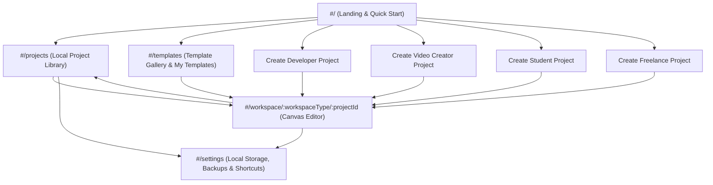

# Information Architecture (`docs/INFORMATION_ARCHITECTURE.md`)

> **Implementation Status:** Fully Implemented and Verified (`v0.1.0-release`). Defines the structural organization, views, navigation patterns, and routing architecture for MindRail Studio.

## 1. Architectural Overview & Zero-Auth Principle

MindRail Studio is a local-first, zero-backend application. Consequently:

- **No Authentication Routes:** There are no `/login`, `/signup`, `/forgot-password`, `/account`, or `/billing` routes.
- **Immediate Workspace Access:** Users move directly between the **Public Landing View**, the **Local Project Library**, the **Template Gallery** (with **My Templates**), the **Active Workspace Canvas Editor** across four specialized workspaces, and **Settings**.



## 2. Routing Strategy

To guarantee compatibility with static hosting providers—including subdirectory deployments such as GitHub Pages (`https://<username>.github.io/mindrail-studio/`) where custom server rewrite rules are unavailable—MindRail Studio uses **Hash-Based Client-Side Routing** (`#/..`) by default, with clean URL path helpers encapsulated in a single router module (`src/app/router.ts`).

| Route Pattern | View Name | Primary Responsibility |
| :--- | :--- | :--- |
| `#/` | **Landing & Quick Start** | Introduces MindRail Studio, shows recent local projects (if any exist in `IndexedDB`), and provides one-click entry points to create a Developer, Video Creator, Student, or Freelance project or import a `.mindrail.json` file |
| `#/projects` | **Project Library** | Lists all locally saved projects in `IndexedDB` with filtering by workspace type (`All`, `Developer`, `Video Creator`, `Student`, `Freelance`), search by title/tags, sort by last updated, duplicate, export, import, and delete actions |
| `#/templates` | **Template Gallery** | Displays 45+ built-in starter templates across 15 categories and user-saved custom local templates under "My Templates", with multi-field search, difficulty filters, favorites, non-mutating preview modal, and "Use Template" action |
| `#/workspace/developer/:projectId` | **Developer Workspace Editor** | Opens the Shared Visual Canvas configured with Developer node tools (Architecture, Workflow, Code Snippet, Task/Bug, Tech Note) and the Task/Architecture companion views |
| `#/workspace/video/:projectId` | **Video Creator Workspace Editor** | Opens the Shared Visual Canvas configured with Video Creator node tools (Scene Storyboard, Script Beat, Shot Item, Audio/SFX Cue), cumulative duration strip, and Production Checklist panel |
| `#/workspace/student/:projectId` | **Student Workspace Editor** | Opens the Shared Visual Canvas configured with Student node tools (Concept Mind Map, Flashcard, Topic Note, Revision Checklist), drift-free Study Timer widget, and Flashcard Practice modal |
| `#/workspace/freelance/:projectId` | **Freelance Workspace Editor** | Opens the Shared Visual Canvas configured with Freelance node tools (Client Task, Project Stage, Deliverable, Brief Note, Review Item), deliverable approval tracker, and stage progress |
| `#/settings` | **Local Settings & Data Management** | Manages appearance preferences, keyboard shortcut reference, local storage inspection, full multi-project backup archive export & restore (`validateBackupArchive`), and local data reset |

## 3. View Responsibilities & Information Structure

### 3.1 Public Landing Page (`#/`)
- **Hero & Value Proposition:** Concise explanation of MindRail Studio's local-first, zero-backend visual workspaces.
- **Quick-Launch Workspace Cards:** Four prominent cards (**Developer Workspace**, **Video Creator Workspace**, **Student Workspace**, **Freelance & Business Workspace**) that either create a blank project immediately or launch the workspace's featured starter template.
- **Continue Working Strip:** If `IndexedDB` contains existing projects, renders the 3 most recently modified projects near the top of the page so returning users bypass marketing copy.
- **Direct Import Dropzone:** "Open `.mindrail.json` Project File" button and drag-and-drop target.

### 3.2 Project Library (`#/projects`)
- **Header Controls:** Search input, Workspace filter pills (`All`, `Developer`, `Video`, `Student`, `Freelance`), Sort selector (`Last Modified`, `Created Date`, `Alphabetical`), `Import Project (.mindrail.json)` button, and `New Project` primary CTA.
- **Project Cards:** Display project title, workspace badge, node/edge counts, last saved relative timestamp, and quick actions (`Open`, `Rename`, `Duplicate`, `Export .mindrail.json`, `Delete`).
- **Storage Health Footer:** Shows local storage status (`IndexedDB Active`, total projects stored, and reminder that data is stored locally in this browser profile).

### 3.3 Template Gallery (`#/templates`)
- **Workspace Filter Tabs:** `All Templates`, `Developer`, `Video Creator`, `Student`, `Freelance & Business`, `My Templates (N)`.
- **15 Category Tabs:** Web Development, UI/UX Design, Graphic Design, Video Editing, Content Creation, Writing & Copy, Social Media, Digital Marketing, Freelance & Business, Photography, Podcast & Audio, Data Analytics, AI & Automation, Education & Research, Product & Startup.
- **Template Cards:** Show template name, target workspace badge, category badge, difficulty badge, setup time estimate, node count summary, included node types, favorite star toggle, and `Use Template` / `Preview` CTAs. User custom templates also feature a delete action.

### 3.4 Canvas Editor & Specialized Workspaces (`#/workspace/:workspaceType/:projectId`)

All three workspaces share a unified **4-Zone Studio Layout** so users maintain spatial muscle memory across domains:

```text
+-----------------------------------------------------------------------------------+
| ZONE A: Top Studio Header (Project Title, Workspace Badge, Save Status,           |
|         Undo/Redo, Workspace Utility Toggles, Import/Export Menu)                 |
+---------------+---------------------------------------------------+---------------+
| ZONE B:       | ZONE C:                                           | ZONE D:       |
| Left Creation | Shared Visual Canvas Viewport                     | Right Context |
| Palette &     | - Infinite pan/zoom surface                       | Inspector &   |
| Outline       | - Typed HTML/CSS nodes + SVG edges                | Workspace     |
|               | - Bottom-left Zoom/Fit HUD & Minimap toggle       | Companion     |
|               | - Workspace Bottom Bar (optional timeline/timer)  | Panel         |
+---------------+---------------------------------------------------+---------------+
```

#### Workspace-Specific Customizations Within the 4-Zone Layout

| Zone | Developer Workspace | Video Creator Workspace | Student Workspace |
| :--- | :--- | :--- | :--- |
| **Zone A (Top Header Extras)** | Filter by Task Status / Environment; Export SVG Diagram | Total Runtime Counter (`MM:SS`) & Shot Readiness (`X/Y Shots`); Export Storyboard Sheet | Study Timer (`25:00` Start/Pause), Mastery Progress (`% Mastered`), `Practice Flashcards` button |
| **Zone B (Left Creation Palette)** | Service, Database, Queue, Client, Workflow Step, Code Snippet, Task/Bug, Tech Note | Storyboard Scene, Script Beat, Shot List Item, VO/Audio Note, Motion Graphic Note, Checklist | Root Topic, Concept Node, Flashcard Node, Topic Summary Note, Revision Checklist |
| **Zone C (Canvas Overlays)** | Architecture boundary groups & protocol edge labels (`HTTPS`, `gRPC`, `SQL`) | Sequential scene number badges (`Scene 01`, `Scene 02`) & cumulative timecode tags | Mind map hierarchical connectors (`Tab` child / `Enter` sibling shortcuts) & mastery badges |
| **Zone D (Right Inspector)** | Service metadata, monospace Code Snippet editor with copy button, Task/Bug status & priority | Scene script editor, framing selector, duration (seconds) input, VO & SFX fields, scene checklist | Concept summary notes, Flashcard front/back editor, confidence rating, revision checklist items |

### 3.5 Settings & Local Data Management (`#/settings`)
- **Appearance & Accessibility:** Toggle `Reduced Motion` (`system` / `on` / `off`), `High-Contrast Node Borders`, and `Default Grid Snap` (`16px` / `8px` / `off`).
- **Local Storage Inspector:** Displays estimated `IndexedDB` usage via `navigator.storage.estimate()` (when supported by the browser), persistent storage permission status, and a one-click **"Export All Projects Backup"** utility.
- **Danger Zone:** **"Clear All Local Studio Data"** action requiring explicit confirmation dialog before wiping `IndexedDB` and `localStorage`.

### 3.6 Import / Export Workflows
- **Export Menu (accessible from Project Library and Editor Header):**
  - `Export Project (.mindrail.json)` — Full lossless project file (P0).
  - `Export Visual Diagram / Storyboard (.svg / .png)` — Local canvas snapshot (P1).
  - `Export Summary Sheet (.md)` — Workspace-formatted Markdown notes/script/study guide (P1).
- **Import Modal (accessible from Landing, Project Library, and Editor Header):**
  - Supports file selection or drag-and-drop.
  - Displays pre-import validation summary (Project Title, Workspace Type, Schema Version, Node/Edge count) or structured validation errors before committing to `IndexedDB`.

## 4. Navigation Hierarchy & Responsive Breakpoints

### Desktop Navigation (`≥ 1024px`)
- Full 4-zone studio layout visible simultaneously.
- Left Creation Palette (`240px` width) and Right Inspector (`320px` width) can be collapsed (`[`, `]`) to maximize canvas viewport space.
- Command Palette (`Ctrl/Cmd + K`) provides instant keyboard access to any route, node creation tool, or export action.

### Tablet Navigation (`768px – 1023px`)
- Left Creation Palette collapses into a compact vertical icon rail (`56px` width).
- Right Inspector opens as a slide-over drawer when a node is selected and dismisses when clicking the canvas background or pressing `Escape`.

### Mobile Navigation (`< 768px`)
- Top Header condenses into a compact bar (`Back to Library`, `Project Title`, `Save Status Icon`, `Overflow Menu`).
- Creation tools move to a floating bottom action bar (`+ Add Node`, `Outline List View`, `Inspector`, `Zoom Fit`).
- Right Inspector renders as an accessible bottom sheet (`50%` or `85%` viewport height) when editing a node.
- Users can toggle between the **2D Visual Canvas** and a **Structured Card/Outline List View** of the same project nodes for comfortable one-handed reading and text editing on narrow screens.
